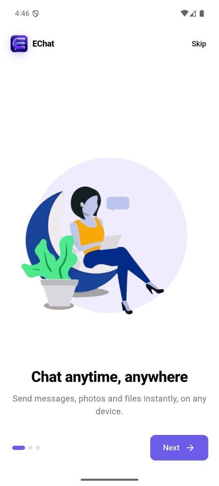
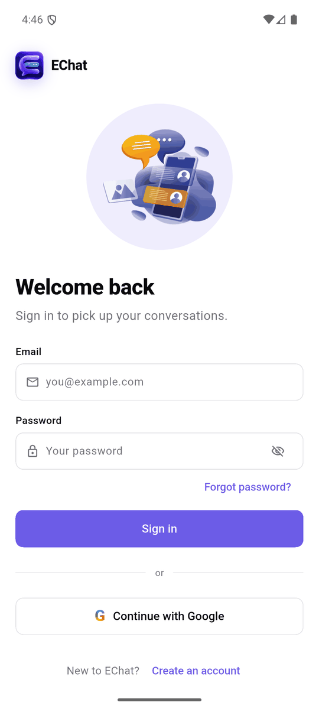
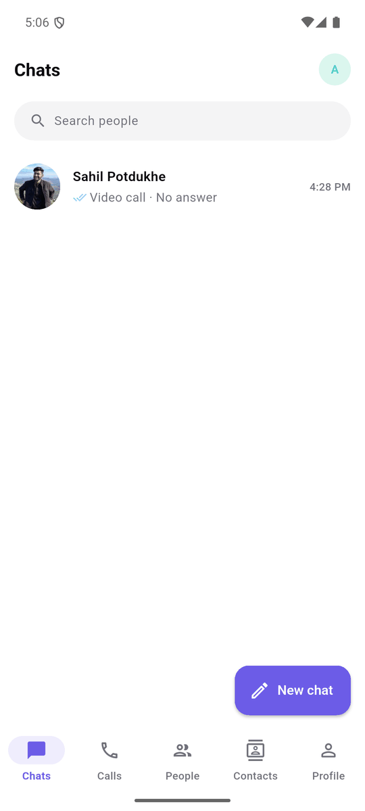
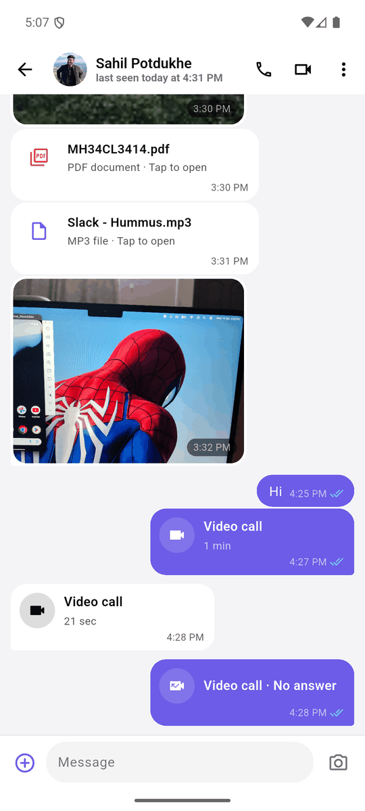
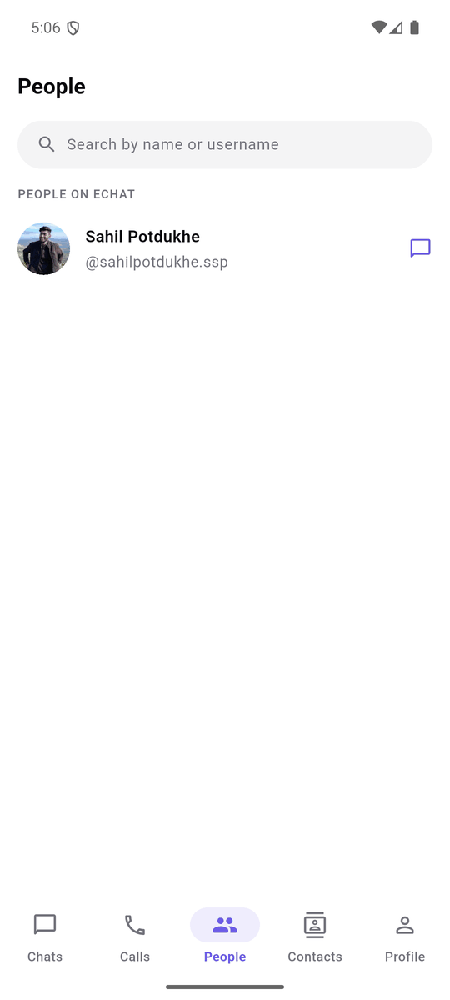
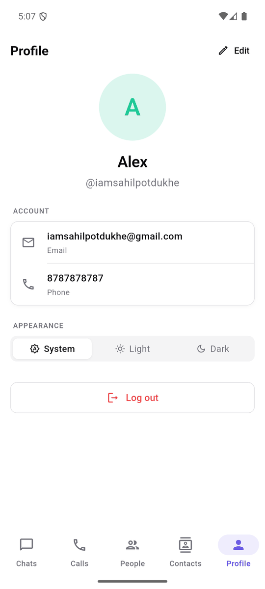
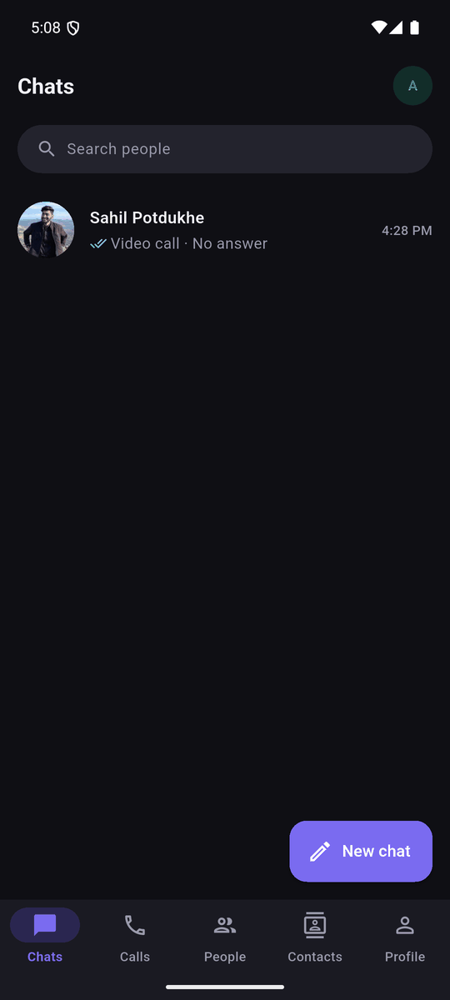
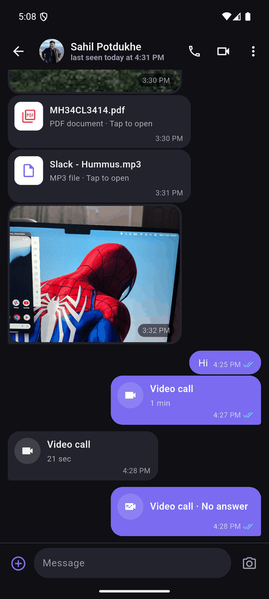
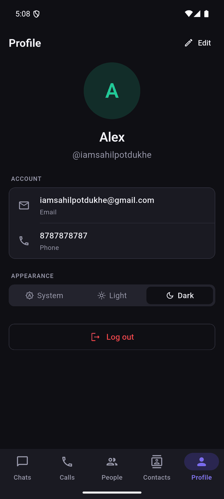

<div align="center">
  

  <p><b>Chat, share and call: a fast, private messenger built with Flutter.</b></p>

  
  
  
  
</div>

---

### 🎥 Demo
<p align="center">
  
</p>

### 🔰 About
**EChat** is a chat app for Android and iPhone. Send messages, photos, videos and files, see when they're delivered and read, and jump into a voice or video call, all in a clean light or dark design that also adapts to tablets.

- Real-time chat on **Firebase Firestore**, with media kept in **Supabase Storage** (photos and videos are compressed before upload).
- One-to-one **voice and video calls** with **Agora**, with a full-screen incoming-call screen that rings.
- **Push notifications** with quick actions: reply or mark as read from the notification, and answer or decline calls. A small **Node.js server on Vercel** sends them and issues call tokens.
- Sign in with **email** or **Google**.

---
### ✨ Features
- **Messaging:** text, photos, videos, PDFs and any other file, with an in-app PDF viewer and video player.
- **Message status:** 🕓 waiting to send, ✓ sent, ✓✓ delivered, blue ✓✓ read.
- **"typing…" indicator** and a reliable **online dot / last seen**.
- **Voice and video calls:** mute, camera on/off, switch camera, speaker. Calls show up in the chat ("Video call · 1 min", "Missed call").
- **Call history** with an *All / Missed* filter.
- **Unread badges** on each chat, the Chats tab and the app icon.
- **Delete** a message or a whole chat, for you or for everyone.
- **People search** by name or username, and **contacts**: see which of your contacts use EChat and invite the rest by SMS (contacts are never uploaded).
- **Profile editing** with a profile picture.
- **Light, dark or system theme**, and a layout that adapts to tablets.
- **Offline friendly:** a "No internet" banner, and messages send once you're back online.

---
### 📱 Screenshots

<table align="center">
  <tr>
    <td align="center"><br><sub>Onboarding</sub></td>
    <td align="center"><br><sub>Sign in</sub></td>
    <td align="center"><br><sub>Chats</sub></td>
  </tr>
  <tr>
    <td align="center"><br><sub>Conversation</sub></td>
    <td align="center"><br><sub>People search</sub></td>
    <td align="center"><br><sub>Profile & theme</sub></td>
  </tr>
</table>

<p align="center"><b>Dark mode</b></p>
<table align="center">
  <tr>
    <td align="center"><br><sub>Chats</sub></td>
    <td align="center"><br><sub>Conversation</sub></td>
    <td align="center"><br><sub>Profile</sub></td>
  </tr>
</table>

<p align="center"><b>Calls</b></p>
<table align="center">
  <tr>
    <td align="center"><br><sub>Incoming call</sub></td>
    <td align="center"><br><sub>Video call</sub></td>
  </tr>
</table>

---
### 🛠 Built with
-  **Flutter** (Dart): one app for Android and iOS
-  **Firebase**: Authentication, Firestore, Cloud Messaging
-  **Supabase Storage**: photos, videos, files and profile pictures
-  **Agora**: voice and video calls
-  **Node.js on Vercel**: push notifications and call tokens (`server/`)
-  **Provider**: state management
-  **Hive**: call history stored on the device
-  **Figma**: UI design

---
### 🗂 Project structure
```text
lib/
├── main.dart            app start-up, theme and routing
├── screens/             chat list, chat, calls, people, contacts, sign in / sign up
├── widgets/             shared UI (avatars, PDF viewer, video player, …)
├── resources/           Firebase, Agora, Supabase, notifications, presence
├── models/              user, message, call and call-log data
├── providers/           app state (Provider)
├── theme/               light and dark colours
└── utils/               helpers and validators
server/                  notification + call-token server (Vercel)
firestore.rules          database security rules
supabase/                storage setup
test/                    unit and widget tests
```

---
## 🚀 Getting started

1. **Clone the repository**
   ```bash
   git clone https://github.com/sahilpotdukhe/EChat.git
   cd EChat
   ```
2. **Install dependencies**
   ```bash
   flutter pub get
   ```
3. **Run the app** (with an Android emulator, iOS simulator or phone connected)
   ```bash
   flutter run
   ```
4. **Run the tests**
   ```bash
   flutter test
   ```

### 🍎 Running on iPhone

The iOS project is set up already; these one-time steps need your own accounts:

1. Install Xcode from the App Store, then run `sudo xcode-select -s /Applications/Xcode.app` and open Xcode once.
2. In the Firebase console (project `echat-888ef`), add an iOS app with bundle ID `com.sahilpotdukhe.echat` (already done; the file is in the repo), download `GoogleService-Info.plist` and put it in `ios/Runner/`.
3. Copy `REVERSED_CLIENT_ID` from that file into `ios/Runner/Info.plist`, replacing `com.googleusercontent.apps.REPLACE_WITH_REVERSED_CLIENT_ID` (needed for Google Sign-In).
4. Run `cd ios && pod install`, then `flutter run` with a simulator or iPhone connected.

For push notifications on a real iPhone (a paid Apple Developer account is needed):

5. Open `ios/Runner.xcworkspace`, pick your team under **Signing & Capabilities**, and add the **Push Notifications** capability.
6. Create an APNs key at developer.apple.com and upload it in Firebase console > Project settings > Cloud Messaging > Apple app configuration.

### 🗂 File storage (Supabase)

Photos, videos, files and profile pictures are stored in Supabase Storage. See
[docs/SUPABASE_SETUP.md](docs/SUPABASE_SETUP.md) for the one-time setup.

## 📋 Requirements

- Flutter SDK: [Installation Guide](https://docs.flutter.dev/get-started/install)
- Firebase account: [Sign up for Firebase](https://firebase.google.com/)
- Supabase account: [Sign up for Supabase](https://supabase.com/)
- Agora account: [Sign up for Agora](https://www.agora.io/en/)

---
## 🤝 Contributing
Contributions are always welcome! If you have an idea that would make EChat better, fork the repo and open a pull request. And don't forget to give the project a ⭐!

1. Fork the project
2. Create your feature branch: `git checkout -b feature/AmazingFeature`
3. Commit your changes: `git commit -m "Add some AmazingFeature"`
4. Push to the branch: `git push origin feature/AmazingFeature`
5. Open a pull request

---
## ➤ Contact
You can reach out to me via the following methods:

- **Email:**  &nbsp;&nbsp;<a href="mailto:sahilpotdukhe.ssp@gmail.com">sahilpotdukhe.ssp@gmail.com</a>
- **Social Media:**
   - &nbsp;&nbsp;[LinkedIn](https://www.linkedin.com/in/sahil-potdukhe/)
   - &nbsp;&nbsp;[GitHub](https://github.com/sahilpotdukhe)
   - &nbsp;&nbsp;[Instagram](https://www.instagram.com/sahilpotdukhe11/)
   - &nbsp;&nbsp;[Twitter](https://twitter.com/SahilPotdukhe)
